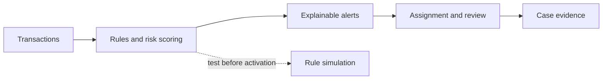

# Didebaan | دیده‌بان

**Persian-first fraud monitoring and AML casework for Iranian fintech teams.**

Django REST API + React RTL operations console. Configurable rules turn transaction signals into explainable alerts, investigator decisions, and exportable evidence—not automatic proof of fraud or certified regulatory compliance.



## What works today

- **Operations:** searchable alert queue, assignment, bulk review, case history, CSV/XLSX exports, light/dark RTL interface.
- **Risk signals:** amount/velocity/behavioral rules, shared devices, merchant abuse, BNPL signals, PEP and managed watchlists.
- **Investigation tools:** rule simulation, customer relationship graphs, Persian-name screening, SLA deadlines, JSON evidence bundles.
- **Backend:** token authentication, role permissions, audit trail, Celery monitoring/escalation, configurable thresholds and rule versions.

## Run locally

Requires **Python 3.11–3.12** and **Node.js 20+**. SQLite works for development; Redis is needed only for queued jobs and scheduled escalation.

From the repository root:

```bash
python3 -m venv .venv
source .venv/bin/activate
pip install -r backend/requirements.txt
python backend/manage.py migrate
python backend/manage.py createsuperuser
python backend/manage.py seed_demo
python backend/manage.py runserver
```

In a second terminal:

```bash
npm --prefix frontend ci
npm --prefix frontend run dev
```

Sign in with the superuser you created. **There is no default username or password.** The frontend proxies `/api` to the backend; set `VITE_BACKEND_URL` when the backend runs elsewhere. `VITE_API_BASE` configures the API origin for a separately deployed frontend.

### Two-minute demo

`seed_demo` creates three fictional customers, three monitored transactions, a shared device/merchant, a demo rule and a fictional watchlist entry. Re-running it preserves existing demo records; it refuses to run with `DEBUG=False`. Use an isolated development database.

1. **صف عملیات:** open a demo alert, inspect its reasons, assign it to yourself and add a note.
2. **تحلیل و انطباق → شبکهٔ ارتباطات:** enter `DEMO-C1` to see shared infrastructure.
3. **غربالگری فارسی:** search `شرکت نمونه آزمایشی` against the fictional demo watchlist.
4. **آزمایش قوانین:** choose `Demo amount threshold`, change `amount_threshold`, and compare matches without activating a rule.
5. **بستهٔ شواهد:** download a case bundle from the alert drawer. Assign an alert to make it appear in the SLA dashboard.

## Roles

Assign Django groups through **Admin → Users → Groups**. Superusers have every role.

| Group | Access |
|---|---|
| `AUDITOR` | Read operations, analytics and exports |
| `INVESTIGATOR` | Read access; review/comment on cases assigned to that username |
| `SUPERVISOR` | Assign cases and perform bulk review |
| `COMPLIANCE_OFFICER` | Manage rules, customers and watchlists; simulation and screening |

An authenticated user without an operational group receives `403`. Investigators cannot self-assign; a supervisor or compliance officer assigns their cases.

## API essentials

- Obtain a token with `POST /api/auth/token/` using `username` and `password`; send `Authorization: Token <your-token>` on subsequent requests.
- Interactive documentation: `/api/docs/`; OpenAPI: `/api/schema/`.
- Health/readiness: `/api/health/`, `/api/ready/`.
- List APIs are paginated. Customer and transaction relationships in POST bodies use their **database UUIDs**, not display IDs such as `DEMO-C1`.

| Workflow | Endpoint |
|---|---|
| Monitor synchronously | `POST /api/transactions/monitor/` with `{"transaction_id":"..."}` |
| Queue monitoring | Same endpoint with `"asynchronous":true`; returns `202` and `task_id` |
| Alert operations | `/api/alerts/`, `/{alert_id}/assign/`, `/{alert_id}/review/`, `/{alert_id}/comments/` |
| Bulk actions | `POST /api/alerts/bulk-assign/`, `/api/alerts/bulk-review/` |
| Filtered exports | `GET /api/alerts/export/?export_format=csv` or `xlsx`; supports queue search/filter/ordering |
| Case history export | `GET /api/alerts/comments-export/?alert_id=...&export_format=csv` |
| Simulation | `POST /api/intelligence/simulate/` with `rule_id`, `configuration`, optional `days` and `limit` |
| Relationship graph | `GET /api/intelligence/graph/?customer_id=DEMO-C1&days=30` |
| Persian screening | `POST /api/intelligence/screen/` with `name` and/or `national_id` |
| SLA dashboard | `GET /api/intelligence/sla/` |
| Evidence bundle | `GET /api/intelligence/case-export/?alert_id=...` |

### Background processing (optional)

Start Redis separately, then run these in separate terminals from `backend/` with the virtual environment activated:

```bash
celery -A config worker --loglevel=info
celery -A config beat --loglevel=info
```

Configure `CELERY_BROKER_URL` and `CELERY_RESULT_BACKEND` for your Redis instance. SLA checks run every 15 minutes; the default assignment deadline is 24 hours, configurable through `ThresholdConfig` (`ALERT_SLA_HOURS`). A broker dispatch failure returns `503`; an accepted task is not a completed result. Inspect worker logs and retrieve the updated transaction/alerts after processing.

## Validate changes

From the repository root, with the Python environment activated:

```bash
python backend/manage.py test aml
python backend/manage.py makemigrations --check --dry-run
python backend/manage.py check
npm --prefix frontend test
npm --prefix frontend run build
```

Frontend tests use a non-browser React renderer; they do not validate visual layout. Backend tests exercise the task pipeline locally and mock queue dispatch; a live Redis/worker deployment needs separate verification.

## Limits and deployment notes

- Simulation supports **THRESHOLD, PATTERN, BEHAVIORAL and GEOGRAPHIC**, at most 500 newest completed transactions over 1–90 days. It uses current retained records/customer attributes—not a historical database snapshot or a false-positive estimate.
- Graphs sample 200 transactions and at most 50 related customers. Screening handles up to 5,000 active entity entries and returns up to 100 ranked matches; larger lists are rejected rather than partially screened. Similarity scores are not probabilities.
- Evidence exports contain sensitive case data and **current** rule snapshots. Histories over 10,000 comments are rejected; use the separate history export. These are not official regulator-specific submissions.
- Default throttles are 100 requests/hour per authenticated user and 20/hour anonymously; queue refresh is every 60 seconds. Configure suitable quotas and a shared cache for production/multiple workers.
- Country lists, demo thresholds and ML scaffolding are examples—not live sanctions feeds, verified legal requirements, or a trained production model.
- For production set `DJANGO_ENV=production`, a strong `SECRET_KEY`, `ALLOWED_HOSTS`, `USE_POSTGRES=True`, database settings and `USE_HTTPS=True` behind a correctly configured HTTPS proxy. Serve the built frontend and collected static files separately; use Gunicorn rather than Django's development server. Review dependency security, backups, monitoring and applicable regulations before deployment.

[Roadmap](ROADMAP.md) · [Architecture](docs/wiki/overview.md) · [Role permissions](docs/wiki/concepts/role-based-access.md)
