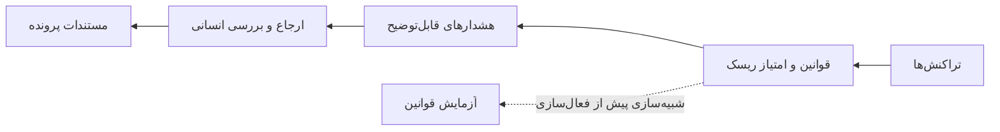

<div dir="rtl">

# دیده‌بان

**سامانهٔ پایش تقلب، مدیریت هشدار و عملیات انطباق برای تیم‌های فین‌تک ایرانی**

دیده‌بان یک API مبتنی بر Django و یک کنسول عملیاتی React راست‌چین است. قوانین قابل‌تنظیم، سیگنال‌های تراکنش را به هشدارهای قابل‌توضیح تبدیل می‌کنند تا بررسی‌کننده بتواند تصمیم، دلیل و مستندات پرونده را ثبت کند.

> این سامانه ابزار تصمیم‌یار است؛ هشدار به‌تنهایی اثبات تقلب نیست و خروجی آن جایگزین تأیید حقوقی یا الزامات رسمی نهادهای ناظر نیست.



## امکانات اصلی

- **مرکز فرماندهی:** شاخص‌های قابل‌کلیک، تصویر ریسک، پرونده‌های قدیمی و وضعیت رسیدگی.
- **صف عملیات:** جست‌وجو، فیلتر، مرتب‌سازی، ارجاع، بازبینی گروهی، تاریخچه و خروجی CSV/XLSX.
- **کارتابل پرونده‌ها:** پیگیری مرحله‌های پرونده از هشدار تا تصمیم نهایی در صندوق‌های نیازمند اقدام، در بررسی، بدون مالک و بسته‌شده.
- **پروفایل موجودیت:** نمایش مشتری، دستگاه و پذیرنده همراه با هشدارها، تراکنش‌ها و روند امتیاز ریسک؛ شناسهٔ ملی و ایمیل برای نقش‌های غیرانطباقی پوشانده می‌شوند.
- **قوانین شفاف:** توضیح سادهٔ هر قانون، پارامترهای قابل‌مشاهده و پیش‌نمایش تغییر پیش از ثبت برای افسر انطباق.
- **هوش و انطباق:** شبیه‌سازی قانون، گراف ارتباط مشتری‌ها، غربالگری نام فارسی، پایش مهلت رسیدگی و بستهٔ شواهد JSON.
- **امنیت عملیاتی:** احراز هویت توکنی، دسترسی مبتنی بر نقش، گزارش ممیزی، تأیید تصمیم‌های مهم و ثبت دلیل برای نتیجهٔ نهایی.
- **رابط فارسی:** RTL، تم روشن/تیره، ناوبری با صفحه‌کلید، اعلان شدت با نماد و متن و رعایت `prefers-reduced-motion`.

---

## راه‌اندازی سریع

### پیش‌نیازها

- Python **3.11 تا 3.12**
- Node.js **20 یا جدیدتر**
- SQLite برای توسعه کافی است.
- Redis فقط برای صف پردازش و ارتقای زمان‌بندی‌شدهٔ هشدارها لازم است.

### ۱) دریافت و آماده‌سازی بک‌اند

از ریشهٔ پروژه اجرا کنید:

```bash
python3 -m venv .venv
source .venv/bin/activate
pip install -r backend/requirements.txt
python backend/manage.py migrate
python backend/manage.py createsuperuser
python backend/manage.py seed_demo
python backend/manage.py runserver
```

در مرحلهٔ `createsuperuser` نام کاربری و گذرواژهٔ خودتان را تعیین می‌کنید. **حساب یا گذرواژهٔ پیش‌فرض وجود ندارد.**

### ۲) اجرای رابط کاربری

در یک ترمینال دوم، از ریشهٔ پروژه:

```bash
npm --prefix frontend ci
npm --prefix frontend run dev
```

رابط درخواست‌های `/api` را به بک‌اند هدایت می‌کند. اگر بک‌اند در مبدأ دیگری اجرا می‌شود، `VITE_BACKEND_URL` را تنظیم کنید. برای رابطی که جداگانه استقرار می‌یابد، از `VITE_API_BASE` استفاده کنید.

### ۳) ورود و مرور دموی دو دقیقه‌ای

فرمان `seed_demo` سه مشتری و تراکنش ساختگی، یک دستگاه/پذیرندهٔ مشترک، قانون نمونه و رکورد ساختگی فهرست پایش می‌سازد. اجرای دوبارهٔ آن دادهٔ نمونهٔ موجود را حفظ می‌کند و در حالت `DEBUG=False` اجرا نمی‌شود؛ فقط از پایگاه‌دادهٔ توسعهٔ جداگانه استفاده کنید.

1. در **مرکز فرماندهی** یکی از کارت‌های شاخص را انتخاب کنید تا صف عملیات با همان فیلتر باز شود.
2. در **صف عملیات** هشدار نمونه را باز کنید، علت‌ها را ببینید، آن را ارجاع دهید و یادداشت ثبت کنید. نتیجهٔ نهایی به دلیل و تأیید نیاز دارد.
3. در **کارتابل پرونده‌ها** میان صندوق‌های «نیازمند اقدام»، «در بررسی»، «بدون مالک» و «بسته‌شده» جابه‌جا شوید و خط زمانی پرونده را ببینید.
4. در **قوانین و شفافیت** قانون `Demo amount threshold` را انتخاب کنید؛ افسر انطباق پیش از ثبت، خلاصهٔ تغییر پارامترها را می‌بیند.
5. در **تحلیل و انطباق ← شبکهٔ ارتباطات** مقدار `DEMO-C1` را وارد کنید تا زیرساخت مشترک نمایش داده شود.
6. در **غربالگری فارسی** نام `شرکت نمونه آزمایشی` را در فهرست ساختگی بررسی کنید.

---

## اجرا با Docker (کل سرویس‌ها)

کل استک — پایگاه‌داده PostgreSQL، Redis، API جنگو با Gunicorn، worker و beat سلری، و کنسول React پشت nginx — با یک فرمان اجرا می‌شود.

**پیش‌نیاز:** Docker Engine ۲۴ یا جدیدتر و Docker Compose v2. برای حافظه حداقل ۲ گیگابایت در نظر بگیرید.

### ۱) تنظیم متغیرهای محیطی

```bash
cp .env.docker.example .env
```

مقادیر پیش‌فرض برای اجرای محلی آماده‌اند. پیش از هر استقرار واقعی، `SECRET_KEY` و `DB_PASSWORD` را تغییر دهید و `DJANGO_ENV=production` بگذارید؛ entrypoint در حالت تولید شروع را با کلید ناامن رد می‌کند.

### ۲) ساخت و اجرای همهٔ سرویس‌ها

```bash
docker compose up -d --build
docker compose ps
```

اولین ساخت چند دقیقه طول می‌کشد (نصب وابستگی‌های پایتون و build فرانت‌اند). سرویس `backend` پس از آماده‌شدن پایگاه‌داده، migrationها و `collectstatic` را خودکار اجرا می‌کند.

### ۳) ساخت کاربر ورود

```bash
docker compose exec backend python manage.py createsuperuser
```

سپس کنسول را روی **http://localhost:8080** باز کنید. رابط با همان میزبان API کار می‌کند؛ nginx مسیرهای `/api/`، `/admin/` و `/static/` را به جنگو می‌فرستد. مستندات API هم روی آدرس زیر در دسترس است:

`http://localhost:8080/api/docs/`

### ۴) دادهٔ نمونه (اختیاری)

```bash
docker compose --profile demo run --rm seed
```

این فرمان دادهٔ ساختگی `DEMO-C1` تا `DEMO-C3`، تراکنش‌ها، دستگاه/پذیرندهٔ نمونه و فهرست پایش ساختگی را می‌سازد. اجرای دوبارهٔ آن بی‌خطر است و فقط در حالت `DEBUG=True` کار می‌کند.

### سرویس‌ها و پورت‌ها

| سرویس | نقش | آدرس یا پورت میزبان |
|---|---|---|
| `frontend` | nginx + کنسول build‌شده، proxy برای API و admin | `http://localhost:8080` (`FRONTEND_PORT`) |
| `backend` | Gunicorn + جنگو، migration و collectstatic در شروع | `http://localhost:8000` (`BACKEND_PORT`) |
| `worker` | اجرای وظایف Celery (پایش صفی و ارتقا) | داخلی |
| `beat` | زمان‌بندی دوره‌ای Celery | داخلی |
| `db` | PostgreSQL 15 با volume ماندگار | داخلی، پورت منتشر نشده |
| `redis` | صف و result backend سلری | داخلی، پورت منتشر نشده |
| `seed` | بارگذاری یک‌بارهٔ دادهٔ نمونه (پروفایل `demo`) | — |

پورت‌های `db` و `redis` عمداً منتشر نشده‌اند تا از بیرون قابل دسترسی نباشند.

### فرمان‌های روزمره

```bash
docker compose logs -f backend          # مشاهدهٔ زندهٔ لاگ‌ها
docker compose logs -f worker           # لاگ وظایف پس‌زمینه
docker compose restart backend          # پس از تغییر تنظیمات
docker compose down                     # توقف و حذف کانتینرها (داده‌ها می‌مانند)
docker compose down -v                  # حذف کامل داده‌ها و volumeها
docker compose exec backend python manage.py test aml
```

معادل کوتاه‌تر با Make: `make docker-up`، `make docker-seed`، `make docker-admin`، `make docker-logs SERVICE=worker` و `make docker-reset`.

### نکته‌های تولید

- `DJANGO_ENV=production`، `SECRET_KEY` واقعی و `DB_PASSWORD` غیرپیش‌فرض الزامی است.
- TLS را در یک reverse proxy جلوی سرویس `frontend` پایان دهید و سپس `USE_HTTPS=True` بگذارید.
- برای دسترسی از دامنه یا IP دیگر، `ALLOWED_HOSTS` و `CORS_ALLOWED_ORIGINS` را به‌روزرسانی کنید.
- `VITE_API_BASE` را خالی بگذارید تا رابط هم‌مبدأ کار کند؛ فقط برای استقرار جداگانهٔ فرانت‌اند روی CDN مقداردهی کنید.
- داده‌های `postgres_data`، `static_data` و `backend_logs` در volumeهای نام‌دار نگهداری می‌شوند؛ برنامهٔ پشتیبان‌گیری را برای `postgres_data` تعیین کنید.

---

## نقش‌ها و دسترسی‌ها

گروه‌ها را از مسیر **Admin → Users → Groups** به کاربر اختصاص دهید. کاربر ابرمدیر به همهٔ نقش‌ها دسترسی دارد.

| گروه | دسترسی |
|---|---|
| `AUDITOR` | مشاهدهٔ عملیات، تحلیل‌ها و خروجی‌ها |
| `INVESTIGATOR` | مشاهده و ثبت بررسی/یادداشت برای پرونده‌های ارجاع‌شده به نام کاربری خود |
| `SUPERVISOR` | ارجاع پرونده و بازبینی گروهی |
| `COMPLIANCE_OFFICER` | مدیریت قوانین، مشتری‌ها و فهرست‌های پایش؛ شبیه‌سازی و غربالگری |

کاربر احراز هویت‌شده‌ای که عضو هیچ‌یک از گروه‌های عملیاتی نباشد پاسخ `403` می‌گیرد. بررسی‌کننده نمی‌تواند پرونده را به خودش ارجاع دهد؛ سرپرست یا افسر انطباق باید این کار را انجام دهد.

---

## API و مسیرهای مهم

- دریافت توکن: `POST /api/auth/token/` با `username` و `password`
- ارسال توکن در درخواست‌های بعدی: `Authorization: Token <your-token>`
- مستندات تعاملی: `/api/docs/`
- مشخصات OpenAPI: `/api/schema/`
- سلامت و آمادگی سرویس: `/api/health/` و `/api/ready/`

| کاربرد | مسیر |
|---|---|
| پایش همگام تراکنش | `POST /api/transactions/monitor/` با `{"transaction_id":"..."}` |
| پایش صفی | همان مسیر با `"asynchronous":true`؛ پاسخ `202` و `task_id` |
| عملیات هشدار | `/api/alerts/`، `/{alert_id}/assign/`، `/{alert_id}/review/` و `/{alert_id}/comments/` |
| عملیات گروهی | `POST /api/alerts/bulk-assign/` و `/api/alerts/bulk-review/` |
| خروجی هشدار | `GET /api/alerts/export/?export_format=csv` یا `xlsx` |
| خروجی تاریخچه | `GET /api/alerts/comments-export/?alert_id=...&export_format=csv` |
| شبیه‌سازی قانون | `POST /api/intelligence/simulate/` |
| گراف ارتباط | `GET /api/intelligence/graph/?customer_id=DEMO-C1&days=30` |
| غربالگری فارسی | `POST /api/intelligence/screen/` |
| گزارش SLA | `GET /api/intelligence/sla/` |
| بستهٔ شواهد | `GET /api/intelligence/case-export/?alert_id=...` |

رابط‌های فهرستی صفحه‌بندی دارند. رابطهٔ مشتری و تراکنش در بدنهٔ درخواست‌های POST با UUID پایگاه‌داده انجام می‌شود، نه شناسهٔ نمایشی مانند `DEMO-C1`.

---

## پردازش پس‌زمینه (اختیاری)

Redis را جداگانه راه‌اندازی کنید، سپس با فعال بودن محیط پایتون، این دو فرمان را در ترمینال‌های جداگانه و از مسیر `backend/` اجرا کنید:

```bash
celery -A config worker --loglevel=info
celery -A config beat --loglevel=info
```

مقادیر `CELERY_BROKER_URL` و `CELERY_RESULT_BACKEND` را برای Redis تنظیم کنید. بررسی SLA هر ۱۵ دقیقه اجرا می‌شود و مهلت پیش‌فرض ارجاع ۲۴ ساعت است؛ مقدار آن از `ThresholdConfig` با کلید `ALERT_SLA_HOURS` قابل‌تنظیم است. پاسخ `202` به‌معنی پذیرفته‌شدن کار است، نه اتمام آن؛ وضعیت worker و هشدارهای به‌روزشده را بررسی کنید.

---

## اعتبارسنجی تغییرات

با فعال بودن محیط پایتون، از ریشهٔ پروژه اجرا کنید:

```bash
python backend/manage.py test aml
python backend/manage.py makemigrations --check --dry-run
python backend/manage.py check
npm --prefix frontend test
npm --prefix frontend run build
```

تست‌های رابط از رندرکنندهٔ React بدون مرورگر استفاده می‌کنند و چیدمان بصری، نسبت کنتراست و حرکت را پوشش نمی‌دهند. تست‌های بک‌اند خط لولهٔ وظایف را به‌صورت محلی بررسی و dispatch صف را mock می‌کنند؛ Redis و worker واقعی باید جداگانه در محیط استقرار تأیید شوند.

---

## محدودیت‌ها و نکات استقرار

- شبیه‌سازی فقط از قوانین `THRESHOLD`، `PATTERN`، `BEHAVIORAL` و `GEOGRAPHIC` پشتیبانی می‌کند؛ حداکثر ۵۰۰ تراکنش تکمیل‌شدهٔ جدیدتر در بازهٔ ۱ تا ۹۰ روز بررسی می‌شود.
- گراف حداکثر ۲۰۰ تراکنش و ۵۰ مشتری مرتبط را نمونه‌برداری می‌کند. غربالگری حداکثر ۵٬۰۰۰ رکورد فعال را می‌خواند و تا ۱۰۰ تطبیق برمی‌گرداند. امتیاز شباهت احتمال نیست.
- بستهٔ شواهد دادهٔ حساس و snapshot فعلی قانون را دارد و جایگزین فرم رسمی نهاد ناظر نیست.
- نرخ پیش‌فرض درخواست‌ها ۱۰۰ درخواست در ساعت برای کاربر احراز هویت‌شده و ۲۰ درخواست در ساعت برای کاربر ناشناس است. نرخ‌ها و cache مشترک را برای تولید متناسب‌سازی کنید.
- فهرست کشورها، آستانه‌های نمونه و زیرساخت ML نمونه هستند؛ آن‌ها feed تحریم زنده، الزام حقوقی تأییدشده یا مدل تولیدی آموزش‌دیده نیستند.
- برای تولید، `DJANGO_ENV=production`، `SECRET_KEY` قوی، `ALLOWED_HOSTS`، `USE_POSTGRES=True`، تنظیمات پایگاه‌داده و `USE_HTTPS=True` را پشت proxy معتبر HTTPS تنظیم کنید. رابط build‌شده و static files را جداگانه سرو کنید و به‌جای سرور توسعهٔ Django از Gunicorn استفاده کنید.

[نقشهٔ راه](ROADMAP.md) · [معماری](docs/wiki/overview.md) · [دسترسی نقش‌ها](docs/wiki/concepts/role-based-access.md)

</div>
